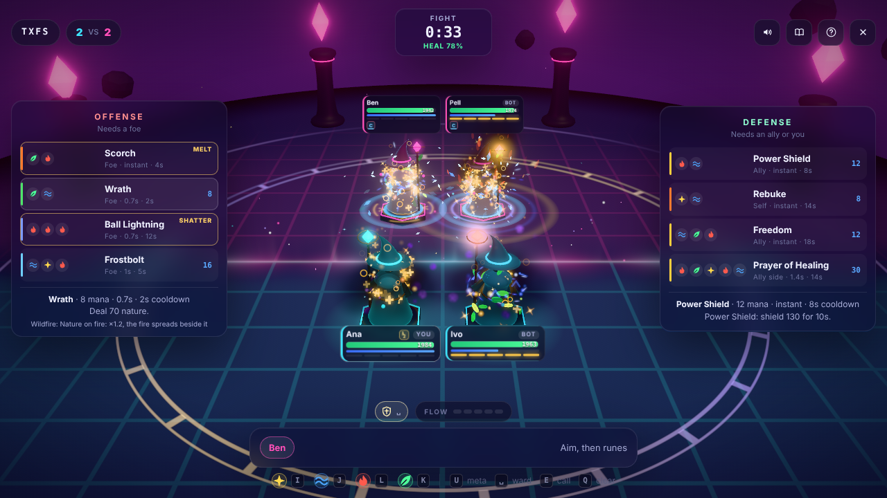

# Chordcast

Real-time arena magic duels where every action is a chord of keys. A few moves pick the target, a run of runes picks the spell, and it fires on the last rune: the faster you type it, the faster it casts. Each match deals a fresh book with fresh chords. You draft your kit from it, then learn its chords while you fight, as the rift keeps rewriting some of them.



- **137 spells** drawn from tabletop and MMO classics: Fireball, Polymorph, Counterspell, Lifebloom, Living Bomb, Death Ward and more.
- **Draft, then fight.** Each player drafts a private kit of 8 from a 16-spell book by typing the chords.
- **Skill on top.** Metamagic (Quicken, Twin, Empower, Extend), a timed ward that turns spells back, school reactions (Melt, Shatter, Eclipse…), a flow streak, sticky aim and team calls.
- **Fair in big fights.** Repeat stuns diminish, and fallen mages keep playing as wisps.
- **Teams of any size**, 1 vs 1 by default, up to 8 vs 8. Bots fill open seats and use every mechanic.
- **Host and join with a code.** Share a four-letter code or a link.
- **Keyboard, gamepad and touch** all use the same twelve keys.
- **Sound that teaches.** Every rune has its own note, so each chord is a tune you learn by ear, and a spell flying at you rises in pitch until it lands. School-voiced spells, music that builds with the surge, and rumble on gamepads and phones. All synthesized: nothing to download.
- **One authority.** The host runs every match and sends the same frames to everyone, as small compressed deltas.
- **Drop and come back.** Lose your connection or reload the page and a bot holds your seat for a minute while you reconnect.
- **Swappable bots.** A deterministic brain today; any `think(view)` object, sync or async, can replace it.

## Quickstart

Needs Node 20 or newer.

```sh
npm install
npm start        # http://localhost:8080 (set PORT to change)
npm test         # engine, host and browser tests; refreshes shots/
```

The browser test uses Playwright's Chromium. If it is not installed yet, run `npx playwright install chromium` once.

## How to play

| | Keyboard | Gamepad | Touch |
|---|---|---|---|
| Moves (aim) | W A S D or arrows | D-pad or left stick | Left pad |
| Runes: star, wave, flame, leaf | I J L K | Y X B A | Right pad |
| Meta (shape the spell) | U, or Shift with a rune | RB | Corner of the right pad |
| Ward (parry) | Space | RT | Shield button |
| Call your aim | E | LT | Corner of the left pad |
| Cancel | Q or Backspace | LB | Center button |
| Book | Tab | Start | Book button |
| Sound on or off | M | | Speaker button |

1. **Draft.** Type a spell's chord (or tap it) to put it in your kit. Only your kit can be cast.
2. **Aim.** Up jumps to the foe row, down comes back (again to snap to you), left and right walk a row. The aim stays between chords; ally spells aimed at a foe land on you.
3. **Cast.** Type the runes; the spell fires on the last one. Faster typing means a shorter cast. Meta then a rune shapes it: Quicken, Twin, Empower or Extend, each for more mana.
4. **Ward.** Raise it just as a hostile spell lands to turn it back on its caster.
5. **Combine.** Fire melts frost, storm shatters it, shadow eclipses holy and more. Clean casts, parries and reactions build flow: faster, cheaper spells. A fizzle breaks it.
6. **Endure.** Repeat stuns land at ½, ¼, then not at all. Fallen mages fight on as wisps. Every 45s the rift rewrites some chords; when it surges, everyone takes rising damage until a team falls.

## Files

| File | Role |
|---|---|
| `core.mjs` | Portable engine: rules, spells, match, bots, messages |
| `host.mjs` | Web server: pages, rooms, codes, the tick loop |
| `page.html` `page.css` `page.mjs` | The client: 3D stage, particles, HUD, input |
| `sound.mjs` | Synthesized sound effects, music and haptics |
| `test.mjs` | Tests |

See [DESIGN.md](DESIGN.md) for the full design and reference.
